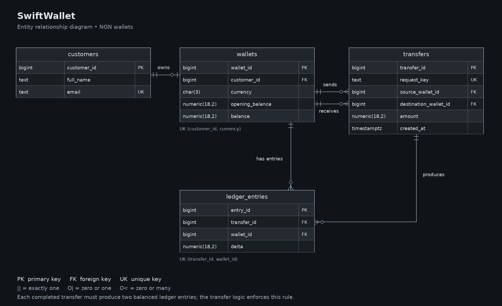
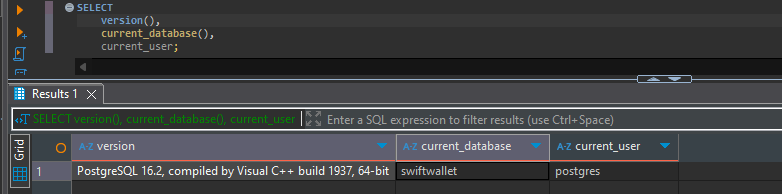
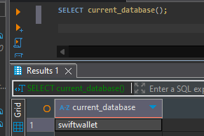
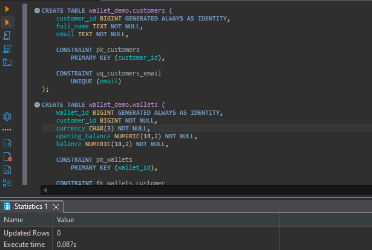
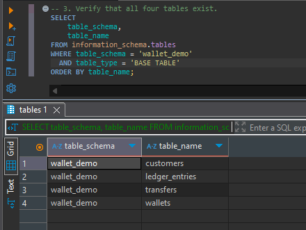
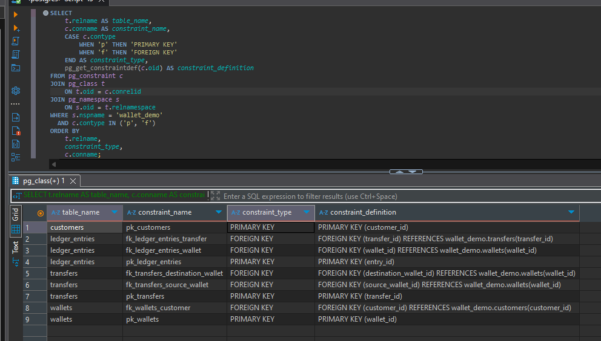

# Portfolio 1: Database Design and Modelling

## 1. Introduction

This portfolio documents the design and implementation of a PostgreSQL
database for SwiftWallet, a simulated digital wallet platform.

The design begins with business requirements, followed by entity
identification, relationship modelling, schema implementation,
normalisation and validation.

## 2. Selected Case Study

### Organisation
SwiftWallet is a simulated fintech platform that allows customers
to hold money in wallets and transfer funds to other customers.

### Database Users
- Customers: view balances, make transfers and view transaction history.
- Support staff: investigate enquiries and locate transfers.
- Finance staff: review ledger entries and reconcile balances.
- Administrators: manage authorised database access.

### Major Data
The database will store customer details, wallets, transfers
and ledger entries.

### Key Operations
1. Register a customer.
2. Create a wallet for a customer.
3. Retrieve a wallet balance.
4. Transfer money between wallets.
5. Retrieve transaction history.
6. Record the debit and credit associated with a transfer.
7. Reconcile wallet balances against ledger entries.

## 3. Business Rules

- Each customer must have a unique email address.
- Each customer may have at most one NGN wallet.
- Every wallet must belong to a customer.
- Transfers must involve two different wallets.
- Transfer amounts must be positive and expressed to at most
  two decimal places.
- A wallet must have sufficient funds before a transfer is completed.
- A successful transfer must debit and credit the same amount.
- A failed transfer must not leave partial changes.
- Repeating an identical transfer request must not move money twice.

## 4. Scope and Assumptions

The initial system supports NGN transfers within SwiftWallet.

External bank transfers, card payments, fees, foreign currencies
and identity verification are outside the scope.

All data will be synthetic. Wallets will receive opening balances
representing funds held at the start of the demonstration.
Deposit processing is outside the initial scope.

Customer-facing and staff-facing applications are not implemented
in this portfolio.

## 5. Identified Entities and Attributes

### Customer
Represents a person registered on the platform.

| Attribute | Purpose |
|---|---|
| customer_id | Unique customer identifier |
| full_name | Customer's name |
| email | Unique customer email address |

### Wallet
Represents a customer's NGN wallet.

| Attribute | Purpose |
|---|---|
| wallet_id | Unique wallet identifier |
| customer_id | Identifies the wallet owner |
| currency | Currency supported by the wallet |
| opening_balance | Funds held at the start of the demonstration |
| balance | Current available balance |

### Transfer
Represents a completed movement of money between two wallets.

| Attribute | Purpose |
|---|---|
| transfer_id | Unique transfer identifier |
| request_key | Identifies a transfer request and its retries |
| source_wallet_id | Wallet sending the money |
| destination_wallet_id | Wallet receiving the money |
| amount | Amount transferred |
| created_at | Date and time of the transfer |

Only completed transfers are retained in this initial model.
Failed attempts and pending transfer workflows are outside its scope.

### Ledger Entry
Represents the signed movement of money in one wallet.

| Attribute | Purpose |
|---|---|
| entry_id | Unique ledger entry identifier |
| transfer_id | Transfer that produced the entry |
| wallet_id | Wallet affected by the entry |
| delta | Negative for a debit; positive for a credit |

A transfer of NGN 500 produces:
- A ledger entry of -500 for the source wallet.
- A ledger entry of +500 for the destination wallet.

## 6. Relationships and Cardinalities

| Relationship | Cardinality |
|---|---|
| Customer to Wallet | One customer has zero or one wallet in the NGN-only scope |
| Wallet to outgoing Transfer | One wallet has zero or many outgoing transfers |
| Wallet to incoming Transfer | One wallet has zero or many incoming transfers |
| Transfer to Ledger Entry | One completed transfer produces exactly two entries |
| Wallet to Ledger Entry | One wallet has zero or many ledger entries |

Each wallet belongs to exactly one customer.
Each transfer has exactly one source and one destination wallet.
Each ledger entry belongs to exactly one transfer and one wallet.

The "exactly two ledger entries" rule is a business invariant.
A foreign key alone cannot enforce it.

## 7. Entity Relationship Diagram



The diagram shows the four entities, their key attributes
and their relationships.

The source and destination relationships between Wallet and
Transfer represent different roles played by the same entity.

The transfer-to-ledger relationship represents the business
requirement for exactly two entries per completed transfer.
Its implementation requires controlled transactional writes;
foreign keys only establish valid references.


## 8. PostgreSQL Setup and Schema Implementation

### 8.1. Environment

The database implementation uses PostgreSQL, accessed through DBeaver.


### 8.2. Connection Verification

The following query identifies the database server version,
active database and connected user:

```sql
SELECT
    version(),
    current_database(),
    current_user;
```

**Observed result:** I can see the current version of postgres running, the database I am connected to and the current user.



### 8.3. Assignment Database Verification

After connecting to the database selected for the assignment,
I executed:

```sql
SELECT current_database();
```

**Observed result:** swiftwallet



This identifies the database used for the implementation.

### 8.4. Schema Implementation

The table definitions are provided in [schema.sql](Olagesin_Samuel_301924961_Schema.sql).

The schema contains four tables:

| Table | Purpose |
|---|---|
| customers | Stores registered customer details |
| wallets | Stores wallet ownership, currency and balances |
| transfers | Stores completed transfers between wallets |
| ledger_entries | Stores signed debit and credit movements |

I executed schema.sql in DBeaver against the assignment database.

**Execution outcome:** Success on execution



### 8.5. Table Verification

After execution, I refreshed the database navigator in DBeaver
and checked that the four tables were present.



### 8.6. Primary Keys and Foreign Keys

Each table has a primary key:

| Table | Primary key |
|---|---|
| customers | customer_id |
| wallets | wallet_id |
| transfers | transfer_id |
| ledger_entries | entry_id |

The foreign-key relationships are:

| Foreign-key column | Referenced column |
|---|---|
| wallets.customer_id | customers.customer_id |
| transfers.source_wallet_id | wallets.wallet_id |
| transfers.destination_wallet_id | wallets.wallet_id |
| ledger_entries.transfer_id | transfers.transfer_id |
| ledger_entries.wallet_id | wallets.wallet_id |

**Verification method:** I ran a query to check all foreign keys under that schema




### 8.7. Unique and Check Constraints

The schema defines the following unique constraints:

- customers.email
- wallets(customer_id, currency)
- transfers.request_key
- ledger_entries(transfer_id, wallet_id)

CHECK constraints enforce:

- NGN as the supported currency.
- Non-negative opening and current wallet balances.
- Positive transfer amounts.
- Different source and destination wallets.
- Non-zero ledger movements.

Required columns use NOT NULL.

The validation section records whether these constraints reject
invalid data as intended.

### 8.8. Rules Requiring Transactional Logic

Table constraints alone do not guarantee every business rule.

The transfer operation must also:

- Check available funds safely under concurrent requests.
- Apply the debit and credit atomically.
- Create exactly two balanced ledger entries.
- Keep wallet balances consistent with ledger movements.
- Handle repeated request keys without moving money twice.
- Reject amounts with more than two decimal places before storage.

These behaviours will be implemented and tested in the
transactions and concurrency portfolio.

## 9. Normalisation and Design Decisions

### First Normal Form (1NF)

Each table has a primary key and stores a single value in
each column. Repeating groups are represented as separate rows.

For example, a wallet's transactions are stored as transfer
and ledger records rather than as a list inside the wallet row.

### Second Normal Form (2NF)

Non-key attributes depend on the whole of each candidate key.

The tables use single-column primary keys. For the composite
alternate keys, wallet attributes describe the customer/currency
wallet, and a ledger delta describes the transfer/wallet entry.

### Third Normal Form (3NF)

Customer details are stored in customers rather than repeated
in wallets or transfers.

Transfer metadata is stored in transfers rather than repeated
in each ledger entry.

This separation reduces update anomalies. Changing a customer's
email does not require modifying their transaction history.

### Deliberate Redundancy

The current wallet balance is stored even though it can be
calculated as:

opening balance + sum of ledger deltas

This avoids recalculating the full ledger for every balance lookup,
but creates an additional consistency obligation.

Ledger entries also store signed amounts derived from their
associated transfers. This supports account-level accounting
queries but requires controlled writes and validation.

The design therefore combines normalised entity data with
deliberately stored financial summaries and movements.

### Reconciliation

A reconciliation query will compare each stored wallet balance
with its opening balance plus ledger movements.

Any difference indicates an inconsistency requiring investigation.

### Limitations

- Exactly two balanced entries per transfer are not enforced
  by foreign keys or simple CHECK constraints.
- Stored balances can become inconsistent if uncontrolled
  direct writes bypass the transfer operation.
- Production use would require restricted database permissions,
  audit controls and stronger operational safeguards.


## 10. Sample Data and Validation

### 10.1. Sample Data

The sample-data script is available in [seed.sql](Olagesin_Samuel_301924961_Seed.sql).

All customer details and transaction records are synthetic.

The dataset contains:

| Table | Actual number of records |
|---|---|
| customers | [ENTER COUNT] |
| wallets | [ENTER COUNT] |
| transfers | [ENTER COUNT] |
| ledger_entries | [ENTER COUNT] |