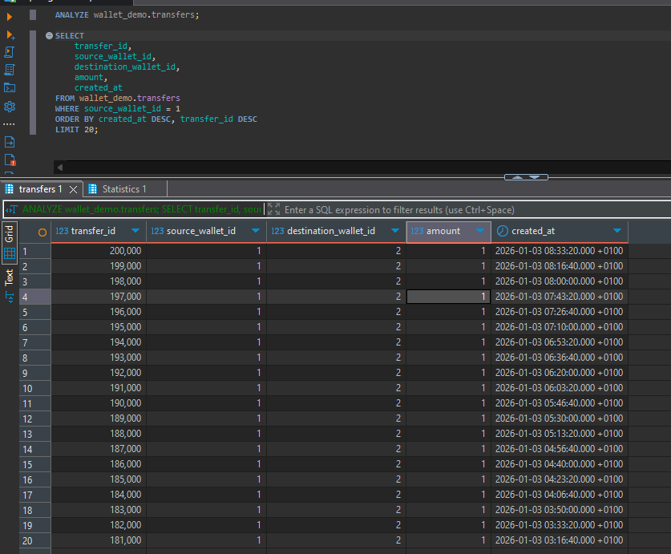
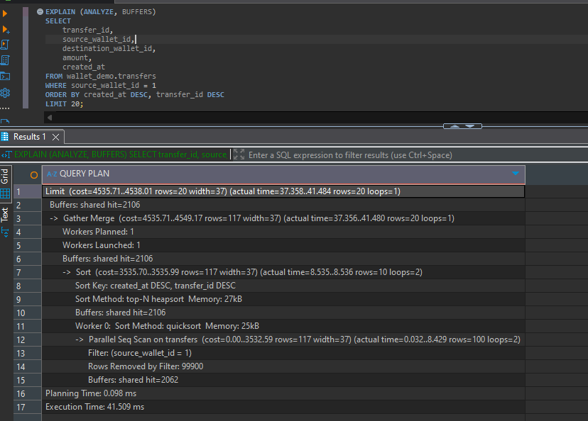
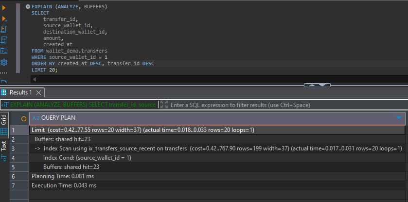

# Portfolio 2: Query Processing and Optimisation

## 1. Objective

This portfolio evaluates a query that retrieves the latest 20
outgoing transfers for a SwiftWallet customer wallet.

The query is measured before and after creating a composite index.

## 2. Dataset and Query

The database contains 1,000 wallets and 200,000 synthetic transfers.
Wallet 1 has 200 outgoing transfers and is used for this comparison.

The query filters by source_wallet_id, orders by created_at and
transfer_id descending, and returns 20 records.

The transfer ID provides deterministic ordering when timestamps match.

## 3. Measurement Method

Planner statistics were refreshed with ANALYZE.

The query was measured three times before indexing and three times
after indexing using EXPLAIN (ANALYZE, BUFFERS).

The median execution time from each group is used for comparison.
The median is the middle value when the three timings are sorted.

The query and dataset were unchanged between measurements.

## 4. Index Implemented

Index script: [index.sql](index.sql)

The composite index contains:

1. source_wallet_id
2. created_at DESC
3. transfer_id DESC

The leading column supports the wallet filter. The remaining columns
match the ordering, potentially allowing PostgreSQL to retrieve the
first 20 matching records without a separate sort.

## 5. Results

### Execution Plan Before Indexing

### Execution Plan After Indexing

## 6. Analysis and Limitations

The index adds storage and maintenance work for inserts, updates
and deletes. Its benefit depends on the query's access pattern.

These measurements come from a small experiment on a cloud database.
Caching, server load and EXPLAIN instrumentation can affect timings.
The results measure database execution rather than complete
application response time.