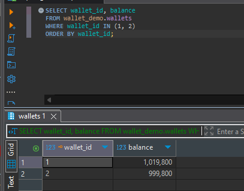
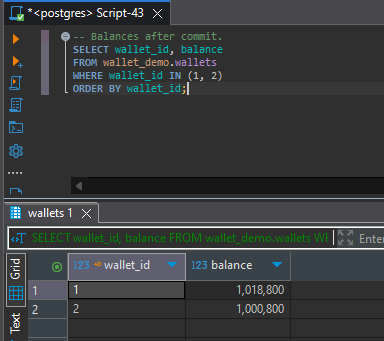
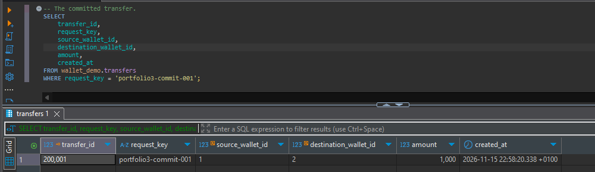
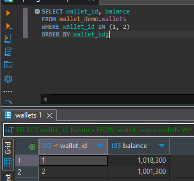
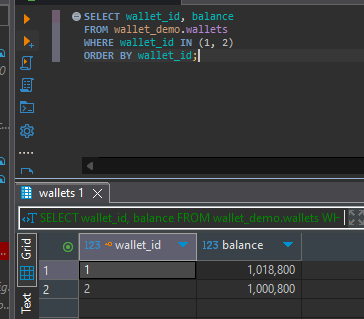
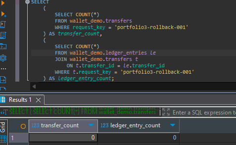
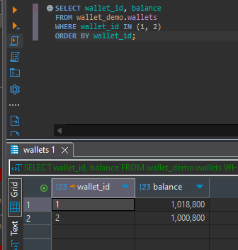
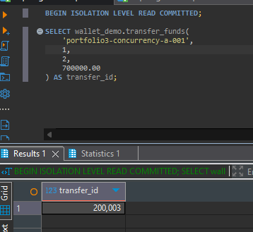
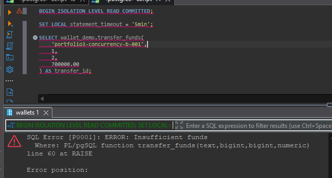
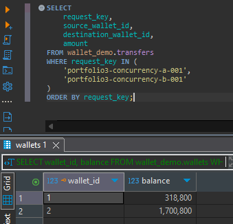

# Portfolio 3: Transactions and Concurrency

## 1. Objective

This portfolio demonstrates how SwiftWallet uses PostgreSQL
transactions and row-level locking to process wallet transfers.

Three scenarios were tested:

1. Committing a successful transfer.
2. Rolling back a transfer.
3. Handling concurrent transfers from the same wallet.

The database from the previous portfolios was reused, with SQL
executed through DBeaver.

## 2. Transfer Implementation

The implementation is available in
[transfer-function.sql](Olagesin_Samuel_301924961_P4_transfer_function.sql).

The transfer_funds function:

- Validates the request key, wallet identifiers and amount.
- Locks both wallets using SELECT ... FOR UPDATE.
- Acquires wallet locks in ascending wallet_id order.
- Checks whether the request key already identifies a transfer.
- Checks the source wallet's available balance.
- Creates the transfer record.
- Debits the source wallet and credits the destination wallet.
- Creates two equal and opposite ledger entries.

The function does not commit independently. Its changes belong
to the surrounding transaction, which the caller either commits
or rolls back.

Locking before checking the balance prevents competing transfers
from making spending decisions using the same available funds.
Consistent lock ordering reduces deadlock risk between calls
that use this transfer function.

## 3. Demonstration 1: Commit

A transfer of NGN 1,000 was made from wallet 1 to wallet 2.
The transaction was completed using COMMIT.

### Starting Balances

| Wallet | Balance before transfer (NGN) |
|---|---:|
| 1 | 1,019,800.00 |
| 2 | 999,800.00 |

### Committed Balances

| Wallet | Balance after commit (NGN) |
|---|---:|
| 1 | 1,018,800.00 |
| 2 | 1,000,800.00 |

### Transfer and Ledger Records

The committed transfer used the request key
`portfolio3-commit-001`.

The ledger contained two entries:

- Wallet 1: -1,000.00.
- Wallet 2: +1,000.00.

### Result

The balance changes, transfer record and ledger entries remained
visible after COMMIT. The combined balance of both wallets
remained unchanged.

## 4. Demonstration 2: Rollback

A transfer of NGN 500 from wallet 1 to wallet 2 was executed
inside an explicit transaction.

The changes were inspected in the same session before the
transaction was cancelled using ROLLBACK.

### Balance Comparison

| Wallet | Before transaction (NGN) | During transaction (NGN) | After rollback (NGN) |
|---|---:|---:|---:|
| 1 | 1,018,800.00 | 1,018,300.00 | 1,018,800.00 |
| 2 | 1,000,800.00 | 1,001,300.00 | 1,000,800.00 |

### Record Verification

After rollback, the verification query returned:

| Record type | Count |
|---|---:|
| Transfers with request key portfolio3-rollback-001 | 0 |
| Ledger entries associated with that transfer | 0 |

### Result

ROLLBACK restored both starting balances and removed the
transaction's transfer and ledger records.

This demonstrates atomicity: the operation did not leave a
partial debit, credit or transfer record.

## 5. Demonstration 3: Concurrent Transfers

Two independent PostgreSQL sessions were used in DBeaver.
Their independence was checked using SELECT pg_backend_pid(),
which returned different process identifiers.

Both transactions explicitly used the READ COMMITTED
isolation level.

### Test Scenario

Wallet 1 started with NGN 1,018,800.

Each session attempted to transfer NGN 700,000 from wallet 1
to wallet 2. The balance could fund either request individually,
but could not fund both.

| Session | Request key | Amount (NGN) |
|---|---|---:|
| A | portfolio3-concurrency-a-001 | 700,000.00 |
| B | portfolio3-concurrency-b-001 | 700,000.00 |

### Step 1: Session A Held the Transaction Open

Session A called the transfer function but did not immediately
commit.

The function acquired locks on both wallet rows. Those locks
remained held while the transaction was open.

### Step 2: Session B Could Not See Uncommitted Changes

Before attempting its transfer, Session B queried the wallet
balances.

It still saw the starting balances rather than Session A's
uncommitted changes.

This demonstrates that the separate session did not perform
a dirty read under READ COMMITTED.

### Step 3: Session B Waited for the Lock

Session B attempted its own NGN 700,000 transfer.

Its transfer statement waited because Session A held the
required wallet locks.

A query against pg_stat_activity and pg_blocking_pids
identified the blocked session and its blocker.

### Step 4: Session A Committed

Session A executed COMMIT, making its changes visible and
releasing its locks.

Session B then acquired the locks and checked the updated
source balance.

Only NGN 318,800 remained, so Session B's NGN 700,000 request
was rejected with an Insufficient funds error.

Session B then executed ROLLBACK.

### Final Verification

| Wallet | Final balance (NGN) |
|---|---:|
| 1 | 318,800.00 |
| 2 | 1,700,800.00 |

The transfer query returned only
`portfolio3-concurrency-a-001`.
No completed transfer existed for
`portfolio3-concurrency-b-001`.

### Result

Only one NGN 700,000 transfer completed.

The second session waited, checked the balance after the
first transaction committed, and rejected a transfer that
could no longer be funded.

READ COMMITTED prevented dirty reads, while the explicit
row locks protected the balance-check-and-update operation.

## 6. Relationship to ACID Properties

| Property | Application in this implementation |
|---|---|
| Atomicity | Rollback discarded the debit, credit, transfer and ledger changes together. |
| Consistency | The tested successful transfers preserved the combined wallet balance and produced equal debit and credit entries. |
| Isolation | Session B could not see uncommitted changes and waited for conflicting wallet locks. |
| Durability | Committed records remained queryable after commit. Crash recovery and failover durability were not tested. |

## 7. Limitations

- The concurrency demonstration covers two competing transfers,
  not a high-volume load test.
- Ordered wallet locking reduces deadlock risk between calls
  using this function; it does not eliminate every possible
  deadlock involving other database operations.
- The database owner can still bypass the function and modify
  tables directly. Production access would require additional
  permissions and controls.
- The function includes request-key handling, but duplicate-request
  behaviour was not separately tested in these demonstrations.
- No database crash, failover or recovery experiment was performed.

## 8. Conclusion

The commit demonstration showed that a successful transfer
persisted all related changes.

The rollback demonstration showed that cancelling a transaction
restored the previous state.

The concurrency demonstration showed that row-level locking,
combined with checking funds after acquiring the locks,
prevented competing transfers from overspending the source wallet.